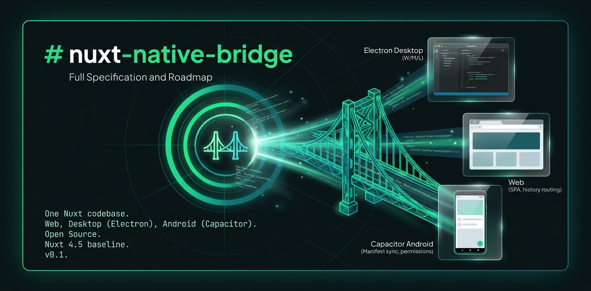

<p align="center">
  
</p>

<h1 align="center">nuxt-native-bridge (nnb)</h1>

<p align="center">
  Build one Nuxt app and ship it as a website, a desktop app for Electron and an Android app.
</p>

---

nnb adds the native shells to a Nuxt project you already have. Your pages, components and
styles stay normal Nuxt. `nnb init` wires the targets, then one CLI builds each one.

## Requirements

| Target | Needs |
| --- | --- |
| Web | Node 20.19+ |
| Desktop (Electron) | nothing extra |
| Android | JDK 21 and the Android SDK |

`nnb doctor` reports which of these it can find.

## 1. Add nnb to your app

Run this inside your Nuxt 3.16+ or 4 project:

```bash
npx @nnb/cli init
```

It asks for three things:

- application id, in reverse-DNS form (`com.you.myapp`), permanent for Android
- application name
- logo path relative to the app. Press Enter to insert a commented example you can fill in later

Then it:

- adds `nuxt-native-bridge`, Capacitor, `@nnb/cli` and the Electron adapter to `package.json`
- adds the `nativeBridge` block to `nuxt.config.ts`
- creates `capacitor.config.ts`, the `android/` project and `electron/main.cjs`
- generates splash and native theme files, plus app icons when you provide a logo
- runs `nnb doctor`

You can re-run `init` at any time. It keeps your edits and only fills in what is missing.

Use a square logo of at least 1024x1024 for the best launcher icon results.

## 2. Configure

Everything nnb reads lives in one block in `nuxt.config.ts`:

```ts
nativeBridge: {
  app: { id: 'com.you.myapp', name: 'My App' },
  brand: { color: '#0D8A8F' },
  apiBase: 'https://api.example.com', // exposed on native targets only
  icons: {
    source: 'public/logo.png', // web and desktop icons + favicons
    android: { glyph: 'public/logo.png', background: '#0D8A8F' },
    splash: 'public/logo.png',
  },
  android: { splash: { hideOn: 'mounted', fade: 300 } },
  backButton: { exitRoutes: ['/'] }, // back here asks to exit instead of navigating
}
```

After changing the logo or brand color, run `npx nnb icons` once. It regenerates the web
icons, Android launcher icons and splash artwork from this block. If you skipped the logo
prompt during `init`, run `npx nnb icons` and give it the path when asked; it fills in the
commented block.

## 3. Know the native limits

Native targets are static single-page apps. Nitro server routes such as `server/api/*` are
not available in the desktop or Android build.

Call a real API origin instead, for example `https://api.example.com`. `apiBase` is exposed
on native targets, so you can keep using relative URLs on the web and switch on native:

```ts
const base = useNativeApiBase()
const url = base ? `${base}/items` : '/api/items'
```

If your app uses `@nuxt/image`, keep `nuxt-native-bridge` before it in the `modules` array
(`nnb init` does this for you). The module disables the ipx provider on native builds,
because `/_ipx/...` URLs need a running server.

## 4. Website

The web target is unchanged. Use your normal dev command:

```bash
npm run dev
```

`npx nnb dev web` exists as an optional wrapper, but it is the same Nuxt dev server.

## 5. Desktop

```bash
npx nnb dev electron                 # dev window with real HMR
npx nnb build electron               # packaged app
npx nnb build electron --installer   # packaged app + Squirrel installer
```

`build electron` generates the static UI, syncs it into the hardened Electron shell and
packages it. The CLI prints the artifact path (under the adapter's `out/` folder).

## 6. Android

```bash
npx nnb build android
```

That one command generates the Android-target web assets, syncs the native project and runs
Gradle. The APK lands here:

```bash
android/app/build/outputs/apk/debug/app-debug.apk
```

Install it on a connected device or emulator:

```bash
adb install -r android/app/build/outputs/apk/debug/app-debug.apk
```

Some vendors (MIUI, HyperOS) show an on-phone confirmation dialog you must accept.

Two device notes:

- the cold-start splash follows the system dark mode, because Android 12+ resolves it
  before your code runs
- Android caches splash and launcher icons per `versionCode`; bump it in
  `android/app/build.gradle` to see new artwork

## Native APIs in app code

Most apps need none of these. Use them when you want platform-specific behavior:

| Composable | What it gives you |
| --- | --- |
| `useNativePlatform()` | `target` (`web`, `electron`, `android`), `os`, `isNative`, `isAndroid`, `isElectron` |
| `useNativeSafeArea()` | real device insets as `insets.top` / `insets.bottom` and CSS variables for camera cutouts and gesture bars |
| `useNativeApiBase()` | your `apiBase` on native targets, `undefined` on web |
| `useNativeApp()` | `onExitRequested()`, `onResume()`, `onPause()`, `exit()` |
| `useBackButton()` | `pushHandler()` / `popHandler()` for screens that intercept Android back |

Splash hiding, status bar theming, safe-area padding and default back-button handling are
already wired. You only add code when you want to customize them.

## CLI

| Command | What it does |
| --- | --- |
| `nnb init` | Wires an existing Nuxt app for all three targets |
| `nnb dev web` | Optional wrapper around the normal Nuxt dev server |
| `nnb dev electron` | Dev server plus the Electron shell with HMR |
| `nnb build electron [--installer]` | Packaged desktop app, optionally with a Squirrel installer |
| `nnb build android` | Generates web assets, syncs Android, runs Gradle, reports the APK |
| `nnb sync` | Regenerates the native files nnb owns: themes, splash, manifest and mirrors |
| `nnb icons` | Regenerates web, desktop and Android icons plus splash artwork |
| `nnb doctor` | Checks Node, config, module install, Electron adapter, JDK, SDK and the Android project |

Run commands from your app directory. The CLI resolves the module and adapters from your
app's `node_modules`.

## Troubleshooting

**Windows blocks the Electron window.** Smart App Control refuses the unsigned
`electron.exe` ("An Application Control policy has blocked this file"). Turn Smart App
Control off or build the desktop app on another machine. Web and Android are unaffected.
Turning Smart App Control back on requires a Windows reset.

**Android cannot reach the network.** The generated manifest always includes
`android.permission.INTERNET`. If you add your own manifest entries, keep that permission.

## More docs

- [Compatibility](docs/compatibility.md): tested Nuxt, Capacitor, Electron, JDK and SDK versions
- [Nuxt module guide](packages/nuxt-native-bridge/README.md): target switching, composables and module behavior
- [CLI guide](packages/nnb/README.md): command details and troubleshooting
- [Electron adapter](packages/adapter-electron/README.md): security model and environment variables

## Contributing

```bash
git clone https://github.com/wissam333/nuxt-native-bridge.git nnb
cd nnb
pnpm install
```

The demo app lives in `packages/nuxt-native-bridge/playground`.

MIT license.
